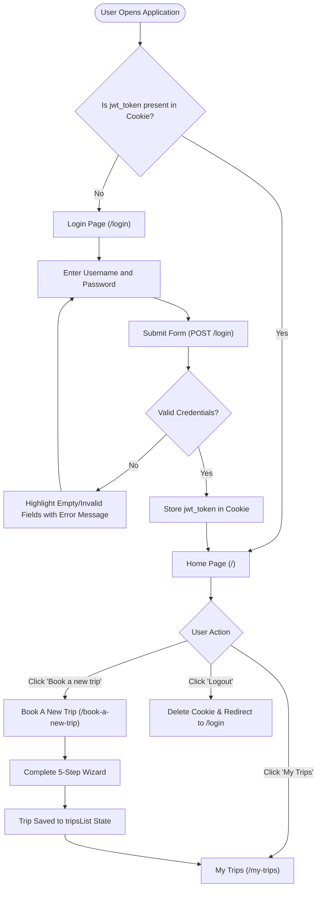
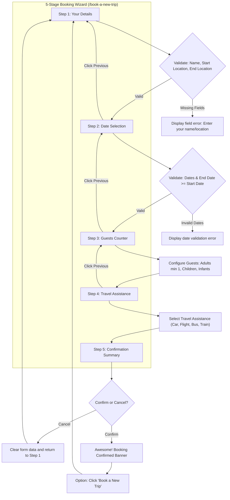
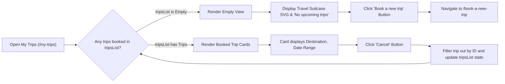

# 🌍 Travel Trip Web Application

A modern, responsive multi-step travel booking web application built with **React.js**, **React Router v5**, and **js-cookie**. The application provides secure token-based authentication, a 5-step booking wizard with real-time field validation, persistent trip management, and responsive layouts across desktop, tablet, and mobile devices.

---

## 🔑 Login Credentials (Demo Access)

Use the following credentials to access the application:

| Field | Value | Description |
| :--- | :--- | :--- |
| **Username** | `rahul` | Registered user account |
| **Password** | `rahul@2021` | Registered user password |
| **Authentication API** | `https://apis.ccbp.in/login` | Method: `POST` with JSON body |
| **Cookie Name** | `jwt_token` | Stores JWT session token via `js-cookie` (valid 30 days) |

> [!TIP]
> You can click the eye icon in the password field (`data-testid="show-password"`) to toggle between masked (`●●●●●●`) and visible plain text.

---

## 🚀 How to Run the Application

### 📋 Prerequisites
- **Node.js**: v14.x or higher (compatible with Node 14, 16, 18, 20, 22, and 24+)
- **npm**: v6.x or higher
- **Git**: Installed on your system

---

### Step 1: Clone the Repository
```bash
git clone https://github.com/KornipatiAkash-1969/Travel-Trip.git
cd Travel-Trip
```

### Step 2: Install Dependencies
```bash
npm install --legacy-peer-deps
```

### Step 3: Start the Development Server

#### Option A: Windows PowerShell (Node.js 17+)
```powershell
$env:NODE_OPTIONS="--openssl-legacy-provider"
npm start
```

#### Option B: macOS / Linux / Git Bash (Node.js 17+)
```bash
NODE_OPTIONS="--openssl-legacy-provider" npm start
```

#### Option C: Node.js 14 or 16
```bash
npm start
```

Once started, open your browser and navigate to:
👉 **`http://localhost:3000`**

---

### Step 4: Build for Production
To generate a production-ready optimized build:

```bash
# Windows PowerShell
$env:NODE_OPTIONS="--openssl-legacy-provider"
npm run build

# macOS / Linux / Git Bash
NODE_OPTIONS="--openssl-legacy-provider" npm run build
```

---

### Step 5: Formatting and Linting
```bash
npm run format     # Format all files using Prettier
npm run lint       # Run ESLint to verify code quality
npm run lint:fix   # Auto-fix linting errors
```

---

## 📊 Flowcharts & How It Works

### 1. Overall Application Navigation Flowchart



---

### 2. Multi-Step Trip Booking Wizard Flowchart



---

### 3. My Trips & Booking Management Flowchart



---

## 🛠️ Detailed Component Breakdown

### 1. Authentication & Route Guard (`/login` & `ProtectedRoute`)
- **Login Component (`src/components/Login`)**:
  - Controlled inputs for `Username` and `Password`.
  - **Empty Input Feedback**: Inputs left empty on submission or with bad credentials highlight with red borders (`.input-error`) and pink background tints.
  - **Password Visibility**: Toggles between text and password masks using `FaRegEye` / `FaRegEyeSlash`.
  - Submits to `https://apis.ccbp.in/login`.
  - On 200 response, stores `jwt_token` with 30-day expiration and redirects to `/`.
- **Protected Route Guard (`src/components/ProtectedRoute`)**:
  - Intercepts route transitions.
  - If `jwt_token` cookie is absent, prevents access and redirects to `/login`.
  - If authenticated, redirects `/login` visits to `/`.

### 2. Home Page (`/`)
- Hero banner with headline: *"Travel. Relax. Memories."*
- Descriptive tagline and call-to-action button: **"Book a new trip"** (`/book-a-new-trip`).
- Responsive layout adapting from side-by-side desktop view to column-reverse mobile view.

### 3. 5-Step Booking Wizard (`/book-a-new-trip`)
- **Interactive Step Indicator**:
  - Numbered circles (`1` to `5`) indicating progress.
  - Completed steps show a green checkmark icon.
  - Current step is highlighted in active blue.
  - On mobile devices (`<= 768px`), automatically adapts into a horizontal scrollable stepper.
- **Step 1: Your Details**:
  - Fields: `Name`, `Start Location`, `End Location`.
  - Validates that non-empty values are provided before proceeding.
- **Step 2: Date Selection**:
  - Fields: `Start Date`, `End Date`.
  - Validates that dates are selected and that `End Date` is not earlier than `Start Date`.
- **Step 3: Guests**:
  - Increment/decrement counter controls.
  - `Adults`: Minimum 1 (the user). Cannot decrease below 1.
  - `Children`: Minimum 0.
  - `Infants`: Minimum 0.
- **Step 4: Travel Assistance**:
  - Toggle checkbox for travel assistance.
  - When checked, dropdown options appear: **Car**, **Flight**, **Bus**, **Train**.
- **Step 5: Confirmation & Success**:
  - Full summary review of name, location, dates, total guests, and assistance selection.
  - **Cancel**: Clears all inputs and resets wizard to Step 1.
  - **Confirm**: Saves trip with unique timestamp ID and transitions to the *Awesome! Booking Confirmed* success banner.

### 4. My Trips Page (`/my-trips`)
- **Empty State**: When no trips exist, displays a custom vector travel illustration, friendly explanation, and **"Book a new trip"** CTA.
- **Active Trips**: Renders cards displaying destination, date range, and a **Cancel** button to remove the trip.

### 5. Header Navigation
- Brand logo styled with cursive `Caveat` font.
- Navigation links to `Home` and `My Trips`.
- **Logout** button: Clears session cookie and redirects to `/login`.

---

## 📁 Project Directory Structure

```
Travel-Trip/
├── public/
│   ├── images/
│   │   └── no-trips-img.svg       # Custom vector empty-state illustration
│   ├── img/
│   │   └── favicon.ico
│   ├── index.html
│   └── manifest.json
├── src/
│   ├── components/
│   │   ├── BookTrip/              # Multi-step coordinator & progress indicator
│   │   ├── Confirmation/          # Step 5: Summary review & success confirmation
│   │   ├── DateSelection/         # Step 2: Date picker with range validation
│   │   ├── Guests/                # Step 3: Adults, children, & infants counters
│   │   ├── Header/                # Top navigation bar with logout
│   │   ├── Home/                  # Landing page with book trip call-to-action
│   │   ├── Login/                 # Authentication, error handling, empty input styling
│   │   ├── MyTrips/               # Booked trips list, cancellation, & empty state SVG
│   │   ├── NotFound/              # 404 fallback page
│   │   ├── ProtectedRoute/        # Authentication route guard
│   │   ├── TravelAssistance/      # Step 4: Travel assistance selection
│   │   └── YourDetails/           # Step 1: User name & location input form
│   ├── App.css
│   ├── App.js                     # Routes configuration & top-level tripsList state
│   ├── index.css
│   └── index.js                   # Application root entry point
├── package.json
└── README.md
```

---

## 🧰 Tech Stack

- **Core Library:** [React 17](https://reactjs.org/)
- **Routing:** [React Router DOM v5](https://v5.reactrouter.com/)
- **Cookie Management:** [js-cookie](https://github.com/js-cookie/js-cookie)
- **Icons:** [React Icons](https://react-icons.github.io/react-icons/) (`FaRegEye`, `FaRegEyeSlash`, etc.)
- **Styling:** CSS3 with Flexbox, CSS Grid, and custom Responsive Media Queries
- **Quality & Formatting:** ESLint & Prettier
